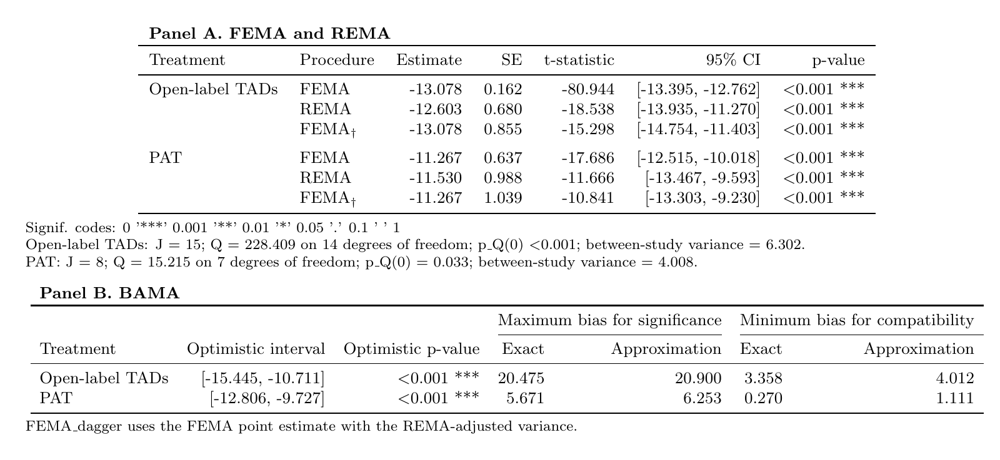
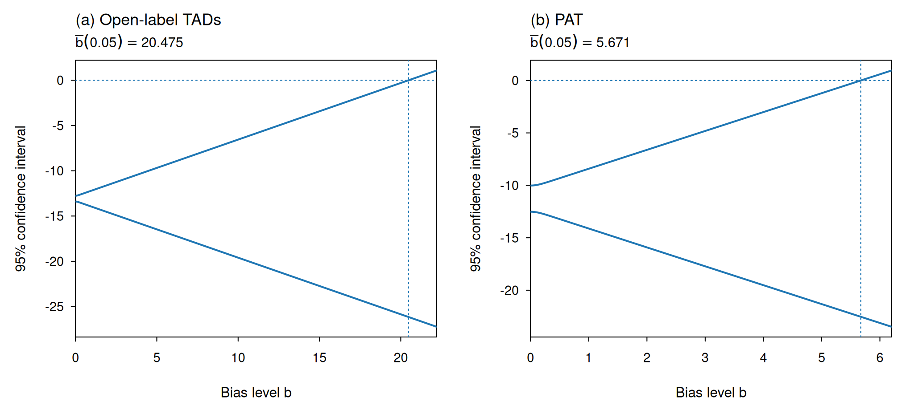
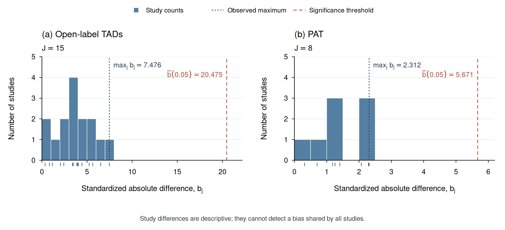

# ba_meta / BaMeta

**Bias-aware meta-analysis for independent study estimates.** This repository
implements the treatment-control methods in Mingxuan Zou and Peng Ding,
*Bias-aware meta-analysis: beyond fixed-effect and random-effects meta-analyses*
(2026 manuscript).

The GitHub repository is named `ba_meta`; the installable R package is `BaMeta`
because R package names cannot contain underscores. The main fitting function
is `ba_meta()`.

Maintainer: Mingxuan Zou <mingxuanzou@uchicago.edu>.
See [release notes](docs/release.md) for publication and CRAN checks.

## Installation

Requires R >= 4.1.0. There are no third-party package dependencies and no
compiled code. Install from GitHub:

```r
install.packages("remotes")  # Needed once to install from GitHub
remotes::install_github("mingxuanzou/ba_meta")
library(BaMeta)
```

Alternatively, from the root of a downloaded or cloned repository:

```sh
R CMD INSTALL .
```

The publication preparation notes are in [docs/release.md](docs/release.md).

## Your own study summaries

Supply one estimate and its standard error (or variance) per independent study:

```r
library(BaMeta)

fit <- ba_meta(
  estimate = c(-0.30, -0.50, -0.20, -0.40),
  se = c(0.10, 0.20, 0.15, 0.12),
  study = c("Study 1", "Study 2", "Study 3", "Study 4")
)
summary(fit)
bama_ci(fit, b = c(0, 0.5, 1, 2))
bama_thresholds(fit)
bama_diagnostics(fit)
```

Use `variance = ...` instead of `se = ...` when your input contains variances.
The default confidence level is 0.95 and the null value is zero. Invalid or
missing values are rejected; studies are never silently dropped. At least two
independent studies are required. Correlated multi-arm contrasts must not be
entered as if they were independent studies.

## Paper-style output

```r
fits <- williams_example()

# Raw numeric tables, suitable for further analysis or CSV export
tables <- bama_tables(fits)
tables$panel_a
tables$panel_b

# Manuscript-style Panels A and B
bama_report(fits, file = "results.html")
bama_report(fits, file = "results.tex", format = "latex")

# Figures
bama_plot_sensitivity(fits)
bama_plot_calibration(fits, binwidth = c(1, 0.5))
bama_plot_q(fits)
```

**Panel A** reports FEMA, REMA (DerSimonian-Laird), and the FEMA estimator with
REMA-adjusted variance (FEMA-dagger): estimate, standard error, normal-reference
test statistic, confidence interval, and p-value. Its notes report study counts,
Cochran's Q, degrees of freedom, Q p-values, and between-study variance.

**Panel B** reports the optimistic interval and optimistic p-value, the maximum bias for significance,
and the minimum bias for compatibility, alongside their first-order
approximations. Exact and conservative Q calculations are explicitly identified.

The optimistic p-value evaluates `bama_pvalue()` at the minimum bias for
compatibility, using the fitted null value and model-checking level. It is
the smallest target-test p-value among the compatible bias levels. Like the
optimistic interval, it is descriptive and has no general type I error
guarantee, because compatibility does not establish an upper bias bound.
The numeric value is returned as `bama_tables(fits)$panel_b$optimistic_p_value`.



Sensitivity curves have solid blue confidence bounds and dotted null and
significance-threshold lines. Calibration histograms use study counts, individual
rug marks, a dotted observed maximum, and a dashed significance threshold.





PDF output uses standard R graphics devices:

```r
pdf("calibration.pdf", width = 10.2, height = 4.65)
bama_plot_calibration(fits, binwidth = c(1, 0.5))
dev.off()
```

The HTML report is self-contained. The LaTeX output is a fragment requiring
`\usepackage{booktabs}`. Every plotting function returns its underlying data
invisibly and restores the previous graphical settings.

## Reproduce the paper example

After installation, from the repository root:

```sh
Rscript scripts/reproduce_williams.R outputs
```

This writes Panels A/B in HTML, LaTeX, Markdown and CSV; sensitivity, Q and
calibration figures in PDF and PNG; study-level calibration/leave-one-out
diagnostics; curve values; and R session information. The same script is
available after installation under
`system.file("examples", "reproduce_williams.R", package = "BaMeta")`.

The included data reproduce these reference results:

| Group | Studies | FEMA estimate | Maximum bias for significance | Minimum bias for compatibility | Maximum observed b_j |
|---|---:|---:|---:|---:|---:|
| Open-label TADs | 15 | -13.078 | 20.475 | 3.358 | 7.476 |
| PAT | 8 | -11.267 | 5.671 | 0.270 | 2.312 |

The Williams data are saved reconstructions of posterior medians and 95%
credible intervals from Figure 2A, with standard errors approximated from
interval widths. They represent within-arm HAM-D changes, not direct
treatment-control causal effects. Arns et al. (2016) is excluded. See
[data provenance](inst/extdata/README.md).

## Statistical interpretation

The BAMA bound is `abs(Delta_j) <= b * sqrt(J) * sigma_FE`. For a **fixed**
chosen bias bound, the interval uses a folded-normal critical value and is
uniformly valid under the independent normal-study model with known variances.
Estimated standard errors rely on the usual large-sample approximation.

- The maximum bias for significance is the first bias level at which the
  interval includes the specified null value.
- The minimum bias for compatibility is the first level not rejected by the
  Q-based model check. It does not give an upper bound on the true bias.
- The optimistic interval evaluates the interval at that data-dependent
  minimum. It is descriptive and need not have nominal coverage.
- Histogram values `b_j` measure observed dispersion around the FEMA estimate.
  They include sampling error and cannot detect a bias shared by all studies.
  They are not automatically valid upper bounds on the true bias.
- Actual leave-one-out pooled shifts differ from `b_j`: on the same reference
  scale, their magnitudes are `weight / (1 - weight) * b_j`. Both are returned.

With `q_method = "auto"`, the Q calculation uses exact meet-in-the-middle
partitioning for at most 36 studies and the conservative `J * b^2` bound above
that limit. `q_method = "exact"` refuses computations above the configured
limit instead of silently approximating them. Conservative p-values can be
larger and their compatibility thresholds smaller than the exact versions.

## Validation and scope

The dependency-free tests compare with independent numerical reference results,
exhaustive small weighted partitions, confidence/p-value boundaries, study
permutations, unit changes, null translations, and explicit leave-one-out refits.

```sh
R CMD build .
R CMD check --no-manual BaMeta_0.1.0.tar.gz
```

This release covers independent scalar study estimates in the current paper.
The earlier network-focused `BiasRobustMeta` package has a different interface.

## Citation and license

Please cite Zou and Ding's BAMA manuscript and the package version used.
`citation("BaMeta")` prints the software citation. Code is distributed under
the [MIT license](LICENSE.md). The data documentation retains attribution to
the source publication.
